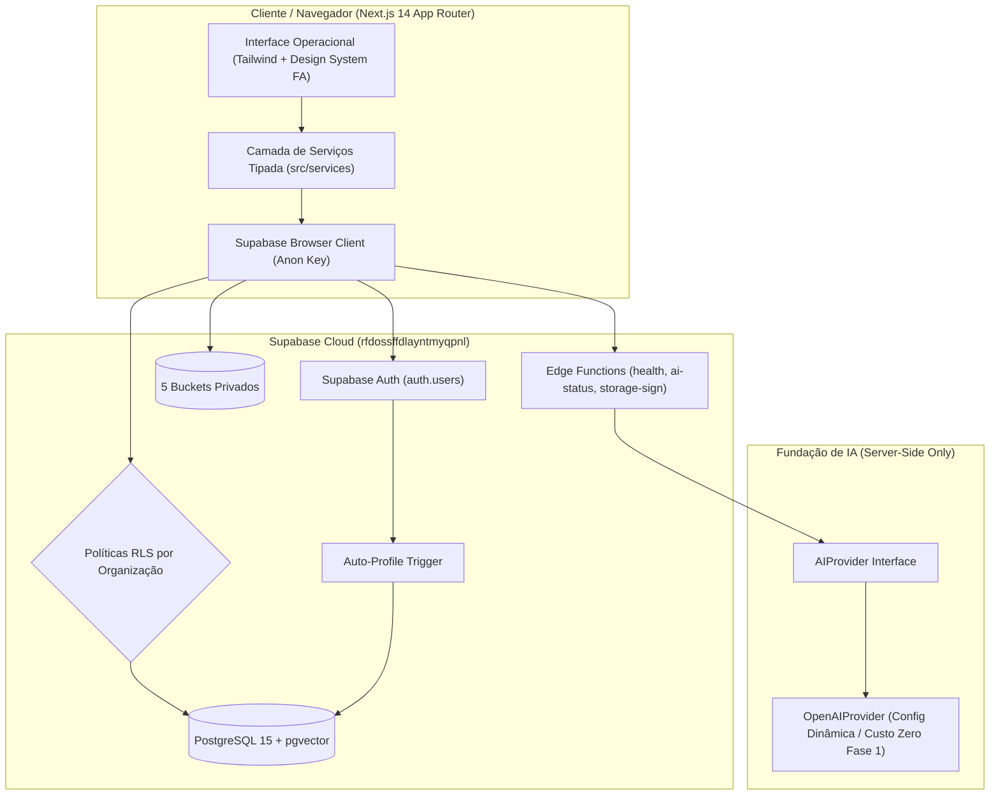

# Studio FA — Arquitetura do Sistema

## 1. Visão Geral

O **Studio FA** é a plataforma interna de produção criativa da agência FA, projetada para atender mais de 60 clientes com escalabilidade multi-organização. O sistema atua como o cérebro operacional de design da agência, conectando ativos de marca, memórias visuais estruturadas e assistência de inteligência artificial governada por humanos.



---

## 2. Pilares de Arquitetura

### 2.1 Multi-Tenancy Centrado em Organizações
Todas as entidades de dados essenciais (`clients`, `client_assets`, `brand_references`, `brand_profiles`, `projects`, `project_slides`, `generation_requests`, `ai_jobs`, `ai_usage_events`, `audit_logs`) contêm obrigatoriamente `organization_id`.
Isso permite à FA operar filiais, operações segregadas e possibilita a futura transformação da plataforma em um produto SaaS sem reescrita de código.

### 2.2 Hierarquia de Papéis (Roles)
Gerenciado na tabela `organization_members`:
- **owner**: Controle administrativo e financeiro total.
- **admin**: Administração operacional de membros, clientes, assets e configurações.
- **manager**: Gestão de clientes, identidades visuais, aprovações, projetos e produções.
- **designer**: Criação e edição de projetos e slides, upload em `client-inputs` e `generated-assets`. Bloqueado de alterar identidades institucionais ou apagar manuais/logos.
- **viewer**: Acesso estritamente de leitura.

### 2.3 Row Level Security (RLS)
Nenhuma tabela opera com `USING (true)` para authenticated. Todas as consultas utilizam as funções SQL otimizadas `is_organization_member()` e `has_organization_role()` com `SECURITY DEFINER` e `STABLE`.

---

## 3. Storage Privado e Validação de Caminhos

Todos os 5 buckets de armazenamento físico são estritamente privados:
1. `client-brand-assets`: Logos, fontes, manuais e ícones oficiais.
2. `brand-references`: Artes anteriores, posts históricos e referências de estilo.
3. `client-inputs`: Fotos do cliente, fotos de produtos e imagens-base.
4. `generated-assets`: Fundos, previews e elementos gerados.
5. `exports`: Peças criativas finais prontas para veiculação.

### Padrão de Caminho
```txt
{organization_id}/{client_id}/{category}/{uuid}.{ext}
```
A política RLS do Storage inspeciona o primeiro segmento do caminho e assegura que somente membros da organização correspondente consigam ler ou gravar arquivos.

---

## 4. Fundação de Inteligência Artificial

A arquitetura de IA foi construída com abstração desacoplada:
- **`AIProvider`**: Interface TypeScript contendo contratos para análise de imagens, análise de marca, geração de embeddings, geração e edição de imagens.
- **`OpenAIProvider`**: Implementação server-side conectada a variáveis dinâmicas de ambiente (`OPENAI_VISION_MODEL`, `OPENAI_IMAGE_MODEL`, `OPENAI_EMBEDDING_MODEL`).
- **Garantia de Custo Zero na Fase 1**: Chamadas de geração de imagem permanecem desabilitadas, retornando status descritivo `501 Not Implemented`. Nenhuma chamada faturável é disparada.
- **Rastreabilidade e Idempotência**: Tabelas `generation_requests` com `input_snapshot` obrigatório e suporte a `idempotency_key`.

---

## 5. Camada de Serviços (Service Layer)

Localizada em `src/services/`, desacopla a interface do banco:
- `organizations/organization.service.ts`: Gestão de tenants e membros.
- `clients/client.service.ts`: CRUD e ciclo de vida de clientes.
- `brands/brand.service.ts`: Versionamento de Brand Profiles e aprovação atômica via RPC.
- `assets/asset.service.ts`: Metadados, validação de tipos MIME e URLs assinadas.
- `projects/project.service.ts`: Projetos, lâminas (slides) e snapshots de versão.
- `compositions/composition.service.ts`: Inicialização de documentos multicamadas, controle de revisão e concorrência otimista.
- `export/export.service.ts`: Renderização offscreen pixel-perfect, geração de Blobs, ZIP em lote e incorporação à memória visual.
- `ai/creative-planner.service.ts`: Planejador de narrativa e direção criativa para posts e carrosséis.
- `ai/prompt-compiler.ts`: Compilador modular de prompts com cálculo de espaço negativo e anti-text baking.
- `ai/queue.service.ts`: Fila assíncrona durável de geração de IA com injeção não-destrutiva de fundos e histórico de versões.
- `ai/ai.service.ts`: Eventos de uso, auditoria e telemetria de custos de IA.
- `auth/auth.service.ts`: Sessão de usuário e perfis.
