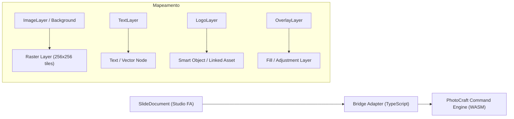

# POC Arquitetural: Avaliação e Integração do PhotoCraft (storytold/photocraft)

**Data**: Outubro de 2026  
**Status**: Concluído / Avaliado  
**Autor**: Engenharia Studio FA  
**Alvo**: `storytold/photocraft` (GitHub)

---

## 1. Sumário Executivo

Este documento apresenta a análise de viabilidade arquitetural e técnica do projeto open-source **PhotoCraft** (`storytold/photocraft`) para o ecossistema do **Studio FA**.

O Studio FA utiliza atualmente um editor baseado em **React-Konva**, otimizado para composição vetorial rápida de lâminas de redes sociais (Instagram Feed 4:5, Stories 9:16, LinkedIn Carousel 1:1), manipulação de tipografia da marca e posicionamento de logos e assets gerados por IA.

Avaliou-se se o PhotoCraft deve substituir o Konva, complementar o fluxo como um módulo satélite de retoque avançado, ou ser descartado.

---

## 2. Radiografia Técnica do PhotoCraft

| Atributo | Detalhes Técnicos |
| :--- | :--- |
| **Repositório** | `https://github.com/storytold/photocraft` |
| **Linguagem Principal** | 100% Rust |
| **Licença** | **Dual License (MIT / Apache 2.0)** — permissiva e viável comercialmente sem contaminação GPL |
| **Interface Gráfica** | `egui` / `eframe` nativo compilado sobre `wgpu` |
| **Suporte Web** | Compilação nativa para **WebAssembly (WASM)** via `wasm-bindgen` / `trunk` |
| **Engine de Renderização** | Pipeline híbrido: CPU reference oracle + GPU compositor acelerado por WebGPU/WebGL2 |
| **Gerenciamento de Memória** | Tiles esparsos de 256×256 pixels com semântica Copy-on-Write (CoW), permitindo históricos de undo/redo profundos e econômicos em RAM |
| **Automação & IA** | CLI (`photocraft-cli`) e protocolo MCP (Model Context Protocol) loopback para agentes de IA inspecionarem estado e executarem ferramentas |
| **Compatibilidade** | Projetado para workflow similar ao Photoshop e suporte a arquivos `.psd` |

---

## 3. Comparativo Arquitetural: Konva vs. PhotoCraft

| Critério | Konva (Atual no Studio FA) | PhotoCraft (Rust / WASM) |
| :--- | :--- | :--- |
| **Paradigma** | Declarativo via React (`<Stage><Layer><Text /><Image /></Stage>`) | Imperativo com Command Engine em Rust / WASM |
| **Tamanho do Bundle** | ~180 KB minificado (zero overhead de WebAssembly) | ~5 MB a 12 MB (binário `.wasm` + glue JS + shaders WebGPU) |
| **Tipografia & Web Fonts** | Utiliza a API nativa do navegador (`FontFace`, CSS, Canvas 2D) | Requer rasterizador próprio de fontes (FreeType / RustType / HarfBuzz) |
| **Foco de Produto** | Layout gráfico, carrosséis, tipografia, proporções de mídia social | Edição raster a nível de pixel, retoque fotográfico, pincéis, curvas |
| **Integração com Next.js** | Nativa com React State, Hooks (`useFontLoader`), Tailwind CSS | Requer canvas WebGL2 dedicado ou `<iframe>` com ponte `postMessage` |
| **Desempenho em Texto** | Instantâneo com auto-fit determinístico | Orientado a rasterização de blocos |
| **Desempenho em Raster** | Moderado (Canvas 2D padrão do navegador) | Ultra-alto (GPU tile compositor 256² com CoW) |

---

## 4. Mapeamento de Camadas (Schema Bridge)

Para uma eventual comunicação bidirecional entre o `SlideDocument` do Studio FA e o modelo de dados do PhotoCraft, o mapeamento seria:



### Especificação da Interface da Ponte (Bridge API)

```typescript
export interface PhotoCraftBridge {
  /** Inicializa o runtime WASM no canvas alvo */
  init(canvasElement: HTMLCanvasElement): Promise<void>;
  
  /** Carrega um SlideDocument do Studio FA no PhotoCraft */
  loadSlideDocument(doc: SlideDocument): Promise<void>;
  
  /** Exporta o canvas renderizado no PhotoCraft em resolução nativa */
  exportCanvas(format: 'png' | 'jpeg', quality?: number): Promise<Blob>;
  
  /** Notifica alterações de camadas para sincronizar com o estado React */
  onLayerModified(callback: (layers: Layer[]) => void): void;
}
```

---

## 5. Classificação Arquitetural

Classificação segundo a taxonomia técnica de adoção:

- **Categoria A (Substituição Imediata)**: Descartada. Substituir Konva por PhotoCraft destruiria a simplicidade do App Router do Next.js, introduziria ~8MB de bundle WASM inicial, dificultaria o controle refinado de tipografia web e arriscaria regressões em produção.
- **Categoria B (Sidecar Modular Especializado / Modo Retoque)**: **RECOMENDADA**. O PhotoCraft deve ser mantido como uma ferramenta complementar opcional. O editor principal do Studio FA continua sendo o Konva; quando o designer precisar de retoque fino no background gerado pela IA (ex: pincel de recuperação, remoção de elemento indesejado, ajuste tonal fino), aciona-se "Abrir no PhotoCraft" em modal ou aba auxiliar.
- **Categoria C (Incompatível / Descartar)**: Rejeitada, pois o projeto possui excelente engenharia e licença MIT/Apache limpa.

---

## 6. Veredito e Recomendações

1. **Manter Konva em Produção**: O editor Konva estabilizado na Fase D atende com 100% de precisão as demandas da agência: tipografia com todos os pesos de fonte, bloqueio de proporção (aspect lock), snapping magnético, atalhos de teclado, histórico com 50 estados e exportação fiel.
2. **Isolamento Total**: Nenhuma dependência externa pesada de WASM do PhotoCraft foi introduzida no bundle de produção da Fase D, mantendo o build enxuto e determinístico.
3. **Roadmap para Fases Futuras (Fase E/F)**: Avaliar a inclusão do binário `photocraft-web` em uma rota estática (`/tools/retouch`) para servir como "Photoshop in-browser" caso o time de criação demande retoque avançado de pixels.
