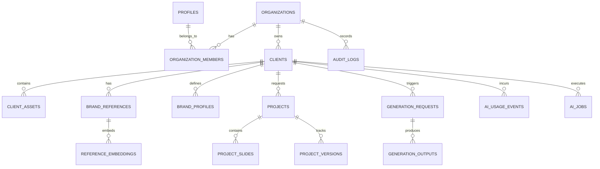

# Studio FA — Documentação do Banco de Dados

## 1. Visão Geral

O banco de dados do **Studio FA** é hospedado na instância gerenciada Supabase PostgreSQL 15+ (Projeto Ref: `rfdossffdlayntmyqpnl`). Todas as tabelas contêm Row Level Security (RLS) habilitado e isolamento estrito por `organization_id`.

---

## 2. Enums do Sistema

- **`app_role`**: `'owner'`, `'admin'`, `'manager'`, `'designer'`, `'viewer'`.
- **`client_status`**: `'active'`, `'paused'`, `'archived'`.
- **`brand_status`**: `'empty'`, `'collecting'`, `'analyzing'`, `'ready'`, `'needs_review'`.
- **`asset_type`**: `'logo_primary'`, `'logo_secondary'`, `'logo_monochrome'`, `'font'`, `'brand_manual'`, `'icon'`, `'graphic_element'`, `'reference_art'`, `'client_photo'`, `'base_image'`, `'generated_image'`, `'export'`, `'other'`.
- **`reference_type`**: `'instagram_post'`, `'carousel'`, `'story'`, `'advertisement'`, `'cover'`, `'branding'`, `'other'`.
- **`brand_profile_status`**: `'draft'`, `'analyzing'`, `'needs_review'`, `'approved'`, `'superseded'`, `'archived'`.
- **`brand_profile_source`**: `'ai'`, `'manual'`, `'hybrid'`.
- **`project_type`**: `'single_post'`, `'carousel'`.
- **`project_status`**: `'draft'`, `'ready'`, `'queued'`, `'generating'`, `'review'`, `'changes_requested'`, `'approved'`, `'exporting'`, `'exported'`, `'failed'`, `'archived'`.
- **`project_format`**: `'instagram_feed_4_5'`, `'instagram_square'`, `'instagram_story'`, `'custom'`.
- **`slide_status`**: `'draft'`, `'ready'`, `'generating'`, `'review'`, `'approved'`, `'failed'`.
- **`generation_operation_type`**: `'brand_analysis'`, `'reference_analysis'`, `'embedding'`, `'image_generate'`, `'image_edit'`, `'variation'`, `'background_generate'`, `'other'`.
- **`generation_request_status`**: `'queued'`, `'processing'`, `'completed'`, `'failed'`, `'cancelled'`.
- **`generation_output_type`**: `'preview'`, `'background'`, `'edited_image'`, `'composite'`, `'final'`, `'auxiliary'`.
- **`ai_job_type`**: `'analyze_brand'`, `'analyze_reference'`, `'create_embedding'`, `'generate_image'`, `'edit_image'`, `'generate_variation'`.
- **`ai_job_status`**: `'queued'`, `'processing'`, `'completed'`, `'failed'`, `'cancelled'`.
- **`approval_status`**: `'pending'`, `'approved'`, `'changes_requested'`, `'rejected'`.

---

## 3. Tabelas Principais

### 3.1 `profiles`
Espelho público do `auth.users` gerenciado via trigger `on_auth_user_created`.
- `id UUID PRIMARY KEY REFERENCES auth.users(id) ON DELETE CASCADE`
- `full_name TEXT`
- `avatar_url TEXT`
- `created_at TIMESTAMPTZ`
- `updated_at TIMESTAMPTZ`

### 3.2 `organizations`
Entidade raiz multi-tenant.
- `id UUID PRIMARY KEY DEFAULT gen_random_uuid()`
- `name TEXT NOT NULL`
- `slug TEXT NOT NULL UNIQUE`
- `logo_path TEXT`
- `settings JSONB NOT NULL DEFAULT '{}'`
- `created_at TIMESTAMPTZ`
- `updated_at TIMESTAMPTZ`

### 3.3 `organization_members`
Vínculo entre usuários e organizações com atribuição de papéis.
- `id UUID PRIMARY KEY DEFAULT gen_random_uuid()`
- `organization_id UUID NOT NULL REFERENCES organizations(id) ON DELETE CASCADE`
- `user_id UUID NOT NULL REFERENCES profiles(id) ON DELETE CASCADE`
- `role app_role NOT NULL DEFAULT 'viewer'`
- `created_at TIMESTAMPTZ`
- `updated_at TIMESTAMPTZ`
- **Constraint**: `UNIQUE(organization_id, user_id)`

### 3.4 `clients`
Clientes atendidos pela FA.
- `id UUID PRIMARY KEY DEFAULT gen_random_uuid()`
- `organization_id UUID NOT NULL REFERENCES organizations(id)`
- `name TEXT NOT NULL`
- `slug TEXT NOT NULL`
- `legal_name TEXT`
- `niche TEXT`
- `instagram_handle TEXT`
- `website TEXT`
- `city TEXT`
- `state TEXT`
- `country TEXT NOT NULL DEFAULT 'BR'`
- `notes TEXT`
- `status client_status NOT NULL DEFAULT 'active'`
- `brand_status brand_status NOT NULL DEFAULT 'empty'`
- `created_by UUID REFERENCES profiles(id)`
- `created_at TIMESTAMPTZ`
- `updated_at TIMESTAMPTZ`
- `archived_at TIMESTAMPTZ`
- **Constraint**: `UNIQUE(organization_id, slug)`
- **Índices**: `organization_id`, `status`, `brand_status`, `name`.

### 3.5 `client_assets`
Metadados dos arquivos físicos persistidos no Supabase Storage.
- `id UUID PRIMARY KEY DEFAULT gen_random_uuid()`
- `organization_id UUID NOT NULL REFERENCES organizations(id)`
- `client_id UUID NOT NULL REFERENCES clients(id)`
- `asset_type asset_type NOT NULL`
- `label TEXT`
- `storage_bucket TEXT NOT NULL`
- `storage_path TEXT NOT NULL`
- `original_filename TEXT NOT NULL`
- `mime_type TEXT NOT NULL`
- `file_size_bytes BIGINT NOT NULL`
- `width INT`, `height INT`, `has_alpha BOOLEAN`
- `checksum TEXT`
- `metadata JSONB NOT NULL DEFAULT '{}'`
- `uploaded_by UUID REFERENCES profiles(id)`
- `created_at TIMESTAMPTZ`
- `updated_at TIMESTAMPTZ`
- `archived_at TIMESTAMPTZ`

### 3.6 `brand_references`
Referências visuais, inspirações e postagens históricas de cada cliente.
- `id UUID PRIMARY KEY DEFAULT gen_random_uuid()`
- `organization_id UUID NOT NULL REFERENCES organizations(id)`
- `client_id UUID NOT NULL REFERENCES clients(id)`
- `asset_id UUID REFERENCES client_assets(id)`
- `title TEXT`, `description TEXT`
- `reference_type reference_type NOT NULL DEFAULT 'other'`
- `tags TEXT[] NOT NULL DEFAULT '{}'`
- `ai_description TEXT`
- `visual_features JSONB NOT NULL DEFAULT '{}'`
- `quality_score NUMERIC`
- `is_approved BOOLEAN NOT NULL DEFAULT true`
- `created_by UUID REFERENCES profiles(id)`
- `created_at TIMESTAMPTZ`
- `updated_at TIMESTAMPTZ`

### 3.7 `brand_profiles`
Memória visual estruturada do cliente, altamente versionável.
- `id UUID PRIMARY KEY DEFAULT gen_random_uuid()`
- `organization_id UUID NOT NULL REFERENCES organizations(id)`
- `client_id UUID NOT NULL REFERENCES clients(id)`
- `version INT NOT NULL`
- `status brand_profile_status NOT NULL DEFAULT 'draft'`
- `source brand_profile_source NOT NULL DEFAULT 'ai'`
- `summary TEXT NOT NULL`
- `colors JSONB NOT NULL` (primary, secondary, accent, background, text)
- `typography JSONB NOT NULL`
- `composition JSONB NOT NULL`
- `photography JSONB NOT NULL`
- `logo_usage JSONB NOT NULL`
- `graphical_elements JSONB NOT NULL`
- `visual_style JSONB NOT NULL`
- `content_style JSONB NOT NULL`
- `spacing_rules JSONB NOT NULL`
- `dos JSONB NOT NULL`
- `donts JSONB NOT NULL`
- `raw_analysis JSONB NOT NULL DEFAULT '{}'`
- `confidence_score NUMERIC`
- `created_by UUID REFERENCES profiles(id)`
- `approved_by UUID REFERENCES profiles(id)`
- `approved_at TIMESTAMPTZ`
- `created_at TIMESTAMPTZ`
- `updated_at TIMESTAMPTZ`
- **Constraint**: `UNIQUE(client_id, version)`
- **Índice Parcial Único**: `CREATE UNIQUE INDEX uq_brand_profiles_single_approved ON brand_profiles(client_id) WHERE (status = 'approved');`

### 3.8 `reference_embeddings` (pgvector)
Vetores semânticos para matching e busca de referências.
- `id UUID PRIMARY KEY DEFAULT gen_random_uuid()`
- `organization_id UUID NOT NULL REFERENCES organizations(id)`
- `client_id UUID NOT NULL REFERENCES clients(id)`
- `reference_id UUID NOT NULL REFERENCES brand_references(id) ON DELETE CASCADE`
- `embedding vector(1536) NOT NULL`
- `embedding_model TEXT NOT NULL`
- `source_text TEXT NOT NULL`
- `created_at TIMESTAMPTZ NOT NULL DEFAULT now()`
- **Índice**: `HNSW` com `vector_cosine_ops`.

### 3.9 `projects`, `project_slides`, `project_versions`
Estrutura de posts e carrosséis com controle de lâminas e snapshots.

### 3.10 `generation_requests`, `generation_outputs`, `ai_jobs`, `ai_usage_events`, `approvals`, `audit_logs`
Infraestrutura de governança, mensuração de tokens e custos, rastreabilidade via `input_snapshot` e idempotência.

---

## 4. Funções SQL e Stored Procedures (RPCs)

1. `is_organization_member(p_org_id UUID, p_user_id UUID)`: Checagem rápida e estável de membresia.
2. `has_organization_role(p_org_id UUID, p_roles app_role[], p_user_id UUID)`: Validação de papéis autorizados.
3. `get_user_organization_role(p_org_id UUID, p_user_id UUID)`: Retorna o papel ativo do usuário.
4. `approve_brand_profile(p_profile_id UUID)`: Transação atômica que valida permissões, superseda o perfil ativo anterior, aprova o novo perfil, atualiza `clients.brand_status = 'ready'` e emite registro.
5. `match_brand_references(p_organization_id UUID, p_client_id UUID, query_embedding vector(1536), match_threshold FLOAT, match_count INT)`: Busca vetorial por similaridade de cosseno com garantia estrita de isolamento de cliente e organização.
6. `create_audit_log(...)`: Registro padronizado de auditoria no banco.

---

## 5. Tabelas da FASE 3 (Estúdio Visual & Editor)

### `project_creative_plans`
- `id` (UUID, PK)
- `organization_id` (UUID, FK organizations)
- `project_id` (UUID, FK projects, CASCADE)
- `version` (INT, padrão 1)
- `brand_profile_id` (UUID, FK brand_profiles)
- `global_direction` (JSONB)
- `slide_plans` (JSONB)
- `reference_ids` (UUID[])
- `created_by`, `created_at`, `updated_at`

### `slide_compositions`
- `id` (UUID, PK)
- `organization_id` (UUID, FK organizations)
- `project_id` (UUID, FK projects, CASCADE)
- `slide_id` (UUID, FK project_slides, UNIQUE, CASCADE)
- `document` (JSONB: canvas, layers, metadata)
- `revision` (INT, padrão 1, concorrência otimista)
- `preview_asset_id` (UUID, FK client_assets)
- `created_by`, `updated_by`, `created_at`, `updated_at`

### `design_templates`
- `id` (UUID, PK)
- `organization_id` (UUID, FK organizations, nullable para templates globais)
- `name` (TEXT)
- `description` (TEXT)
- `format` (project_format)
- `template_type` (TEXT)
- `document` (JSONB)
- `thumbnail_url` (TEXT)
- `is_global` (BOOLEAN, padrão false)
- `created_by`, `created_at`, `updated_at`

